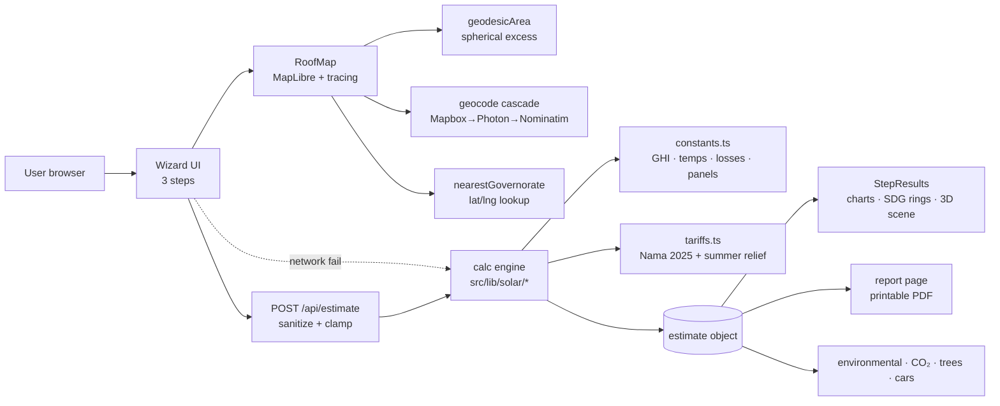

# Oman Rooftop Solar Estimator — Techathon Explanation

> **One line:** A web app where anyone in Oman traces their roof on a satellite map and instantly gets an
> Oman-specific solar estimate — system size, energy yield, bill savings, payback, CO₂ avoided — plus
> alignment with **SDG 7**, **SDG 11** and **Oman Net Zero 2050**.

---

## 1. The Problem

Oman has some of the best solar resources on Earth — **5.5–6.5 kWh/m²/day** of Global Horizontal Irradiance
(GHI) and 300+ sunny days a year — and a national commitment to **Net Zero by 2050**. Yet there is no free,
instant, Oman-specific way for a homeowner or business to answer one question:

> **"What could *my* roof produce and save?"**

Today the answer means calling installers and waiting weeks for a site visit — a slow, sales-driven funnel.
Generic online calculators fail Oman because they assume flat prices and temperate climates, ignoring:

- Oman's **tiered Nama tariffs** (14/18/32 baisa, plus summer relief)
- **Extreme summer heat** that derates panels ~12%
- **Desert dust** that costs ~7.5% of yield between cleanings
- A **~96% gas-fired grid** (0.65 tCO₂/MWh) with real carbon implications

**The gap: no public, instant, data-driven solar decision tool built for Omani reality.**

---

## 2. The Solution

**Oman Rooftop Solar Estimator** — a production-ready Next.js platform with a 3-step wizard:

1. **Find your roof** — search an address or tap a city, fly to the satellite view, and *trace your roof*
   with a polygon tool. Area is computed geodesically; the governorate (and its solar data) auto-detects.
2. **Property details** — pick Home/Business, enter consumption as **OMR bill or kWh** (the app converts
   between them using the real tariff table), choose roof type, orientation and dust level.
3. **Results** — instantly: system size (kWp, panel count), monthly & annual generation, bill savings,
   payback, ROI, NPV, LCOE, CO₂ avoided, and SDG 7 / SDG 11 / Net Zero 2050 trackers — with a loss
   breakdown and assumptions card that document every input, plus a **printable PDF report**.

The product is a **public-good decision tool aligned with a national target** — free is the point.

---

## 3. Demo Flow (what judges will see)

1. Search **"Salalah"** (or click a city chip) → map flies to the location.
2. **"Trace my roof"** → click corners on the satellite image → live area readout; **"Demo roof"** shows a
   sample trace instantly (~460 m² at ISM Darsait, inside the offline tile cache).
3. Step 2 → type **50 OMR** → app converts to kWh via the real tariff schedule ("users enter a bill,
   not energy units").
4. **Calculate** → read the hero row: system size · annual generation · annual savings · payback.
5. Scroll: loss-breakdown card (heat, dust, inverter, wiring, shading) and assumptions card — **every
   input is visible**, so the demo documents itself live.
6. Toggle dust Low→High or Home→Business → watch yield/savings change (sensitivity in front of the user).
7. **Generate the PDF report** → clean, branded, printable, with disclaimer.

**Crash plan:** the calculation engine runs fully client-side too, so even if the map lags on a slow venue
network, the numbers are shown from the sample inputs.

---

## 4. Tech Stack

| Layer | Technology |
|---|---|
| Frontend | Next.js 15 (App Router) · React 19 · Tailwind CSS 3 · TypeScript (strict) |
| Mapping | MapLibre GL JS (Mapbox-GL-compatible, tokenless) + custom polygon tracer |
| Imagery | Esri World Imagery (free, no key) **or** Mapbox Satellite v9 (when token set) |
| Geocoding | Cascade: Mapbox → Photon → Nominatim (all OSM-based, Oman-bounded) |
| Charts | Recharts (monthly energy, cumulative savings) |
| Motion / 3D | `motion` transitions + animated counters · react-three-fiber live 3D roof scene (code-split) |
| Backend | Next.js API route `POST /api/estimate` + **shared TS calc engine** |
| Storage | `localStorage` for report persistence (swap-ready for Supabase/PostGIS) |

---

## 5. Architecture



**Key architectural decision — one source of truth:** the *same* TypeScript calculation engine runs in the
UI **and** behind the API route, so results are identical everywhere. The API sanitizes and clamps every
input server-side (area, tariff schedule, governorate key, rates all validated against allow-lists). If the
network fails during Calculate, the wizard degrades gracefully to the local engine — the map and the math
are fully independent concerns.

**Offline resilience:** `scripts/cache-tiles.mjs` pre-caches Esri imagery (zooms 5–18) for the demo zone
(Indian School Muscat, Darsait) into `public/tiles/`, served by Next.js itself — the demo keeps satellite
imagery even when venue Wi-Fi drops.

---

## 6. The Calculation Engine (the interesting part)

All logic lives in `src/lib/solar/` and is pure, shared, and testable.

### 6.1 Irradiance & climate — per governorate
- **11 governorates** each carry GHI (5.5–6.5 kWh/m²/day, Oman Solar Atlas) and **12 monthly mean
  temperatures** (climate normals — no weather API needed). Dhofar's Khareef monsoon seasonality is built
  into its data; Musandam's lower irradiance is reflected too.
- **Tilt/transposition:** plane-of-array gain **C_tilt = 1.035** at the 22° optimal tilt, 1.0 for flat
  roofs (which use 8°), multiplied by orientation factor (south 1.0 → east/west 0.92, mixed 0.95).

### 6.2 Losses — the Oman-specific part
- **Heat derating (NOCT cell-temperature model):**
  `T_cell = T_amb + (NOCT − 20)/800 × 950` with NOCT = 45°C → cells run ~30°C above ambient; power falls
  **−0.35%/°C above 25°C STC** → ~11.5% mean annual heat loss (up to ~17% in summer peaks).
- **Dust & soiling:** daily deposition model `f = 1 − r·t/2`, r = 0.25%/day; a standard **60-day cleaning
  cycle → 7.5% loss**, configurable (30/60/120-day cycles low/typical/high dust).
- **Fixed system losses:** inverter 5% · wiring 2% · shading 5% · other 3.8% → base PR ≈ 0.85.
- **Combined performance ratio ≈ 0.69** → specific yield ≈ **1,500 kWh/kWp/yr** for Muscat —
  deliberately conservative vs. the **1,650–1,750 kWh/kWp/yr** (PR 0.77–0.81) that well-run real-world
  rooftop systems achieve; the tool under-promises so installers can beat it.

### 6.3 Sizing — demand-matched, not roof-max
- Usable roof = traced area × **75%** (excludes AC units, tanks, walkways).
- Capacity density **0.21 kWp/m²** (550 Wp N-type TOPCon panels on 2.583 m²) → live panel count.
- Recommended size = **min(roof potential, demand-matched size)**; an honest note appears when the roof
  could host more than consumption needs ("avoid paying for unused capacity").

### 6.4 Tariffs — APSR regulation, effective 1 Jan 2025
| Category | Rate |
|---|---|
| Residential primary | 14 b/kWh ≤4,000 kWh · 18 b 4,001–6,000 · 32 b >6,000 |
| Residential additional | 22 b ≤4,000 · 26 b 4,001–6,000 · 32 b >6,000 |
| Non-residential | flat 25 b/kWh |

Monthly bills are computed **tier-by-tier, month-by-month** (with vs without solar), including
**Nama summer relief for primary accounts** (May −15/10/5%, Jun–Aug −20/15/10% per slab) and
**surplus-export credit under net metering** (14 b/kWh default). `billToConsumption()` inverts the table,
so an OMR bill input round-trips exactly to kWh.

### 6.5 Financials & environment — 25-year horizon
- Capex = kWp × **300 OMR/kWp** (KB turnkey range 250–350, configurable).
- O&M 1.5%/yr (inflated at 2% CPI) · panel degradation 0.55%/yr · tariff escalation 2%/yr ·
  **5.5% discount rate** · 25-year analysis.
- Outputs: simple payback (interpolated), 25-yr ROI, NPV, LCOE.
- Carbon: **0.65 tCO₂/MWh** (Oman's ~96% gas-fired grid) → CO₂ avoided; equivalents: mature tree
  **21.77 kg CO₂/yr**, average car **4.6 t CO₂/yr**.

### 6.6 SDG trackers (product layer)
- **SDG 7** = energy self-sufficiency (share of demand met by solar).
- **SDG 11** = blend of bill relief + clean-energy adoption.
- **Net Zero 2050** = self-sufficiency share — mapped to Oman's national target.

---

## 7. Accuracy & Honesty

- Muscat example: **100 m² roof → ~16 kWp → ~24,000 kWh/yr → ~67% PR → ~1,495 kWh/kWp/yr** — matches
  published Oman literature.
- Payback is **~17–19 years** because Oman's 14-baisa first tier is among the world's cheapest power —
  the app shows honest numbers, not inflated ones. The economics are driven by high consumers
  (>4,000 kWh/month) and commercial users on the flat 25-baisa tariff.
- Estimates are **engineering planning figures** — every input is documented in the results screen and
  the PDF report carries a disclaimer. No weather forecasting: long-term climate averages describe a
  typical year.
- A 16 kWp system avoids **~15 t CO₂/yr ≈ 700 trees or 3 cars off the road, every year**.

---

## 8. Data Sources

- **Irradiance:** Oman Solar Atlas / Global Solar Atlas (GHI 5.5–6.5 kWh/m²/day, per governorate)
- **Tariffs:** Authority for Public Services Regulation (APSR), effective 1 January 2025
- **Temperatures:** long-term monthly climate normals per governorate
- **Grid intensity:** IEA-based, Oman ≈ 0.65 tCO₂/MWh
- **Imagery:** Esri World Imagery / Mapbox Satellite v9
- **Address search:** Photon / Nominatim © OpenStreetMap contributors

---

## 9. How to Run

```bash
cd oman-solar-estimator
npm install
cp .env.example .env.local   # optional — the app runs with zero env vars
npm run dev                  # http://localhost:3000
```

Production: `npm run build && npm start`. Offline tiles: `node scripts/cache-tiles.mjs` (once, while
online). Convenience: `./start-dev.sh` boots the dev server and opens the browser.

### API

```bash
curl -X POST http://localhost:3000/api/estimate \
  -H "Content-Type: application/json" \
  -d '{"roofAreaM2":350,"propertyType":"residential","governorate":"muscat",
       "monthlyConsumptionKwh":3500,"tariffSchedule":"primary"}'
```

Returns the full estimate: system, monthly/yearly series, financials, environmental, SDG scores —
inputs validated and clamped server-side.

---

## 10. Project Structure

```
src/
├─ app/
│  ├─ page.tsx                # Landing + wizard
│  ├─ layout.tsx              # Theme provider, fonts, metadata
│  ├─ globals.css             # Tailwind + print styles
│  ├─ report/page.tsx         # Printable PDF report
│  └─ api/estimate/route.ts   # POST estimate API (sanitized inputs)
├─ components/
│  ├─ map/RoofMap.tsx         # MapLibre map + custom polygon tracer
│  ├─ wizard/                 # 3-step wizard (map → details → results)
│  ├─ charts/                 # Recharts (monthly energy, cumulative savings)
│  ├─ sdg/SdgBadges.tsx       # SDG 7 / SDG 11 / Net Zero 2050 rings
│  ├─ three/                  # react-three-fiber 3D roof scene (code-split, safe fallback)
│  └─ ui.tsx, Header.tsx, Footer.tsx, ThemeProvider.tsx, Hero.tsx, anim.tsx
├─ lib/
│  ├─ solar/                  # constants · tariffs · calculator (shared engine)
│  ├─ geo/                    # geodesic area · geocode cascade
│  └─ format.ts
└─ types/index.ts             # wizard reducer state + storage key
scripts/cache-tiles.mjs       # offline satellite tile cache (demo zone)
public/tiles/                 # pre-cached Esri imagery, served by Next.js
```

---

## 11. Known Limitations & Roadmap

**Honest limitations today:**
- Estimates are planning-grade, not quotes — shading uses a flat 5% factor, not per-roof shadow analysis.
- Map geocoding depends on free OSM providers when no Mapbox token is set.
- No authentication — traces and estimates live in `localStorage` (per-device).

**Roadmap:**
- Supabase/PostGIS persistence of traces & estimates → shareable links
- 3D-building shading analysis (LiDAR / solar-potential layer)
- Battery + inverter options modelling
- Arabic (RTL) UI
- Server-side PDF generation (jsPDF) with branded template

---

## 12. Why This Matters

Oman is turning its sun into **Net Zero 2050**. This tool puts that goal in the hands of every rooftop
owner — instilling solar adoption decisions with transparent, honest, local data instead of sales visits.
For installers it is a **lead-generation** layer; for the public and partners like Nama it is an
**education and awareness** tool. Free is the point — it is a public good, aligned with **SDG 7**
(affordable & clean energy) and **SDG 11** (sustainable cities & communities).

*Estimates are indicative planning figures, not financial advice or quotations.*
